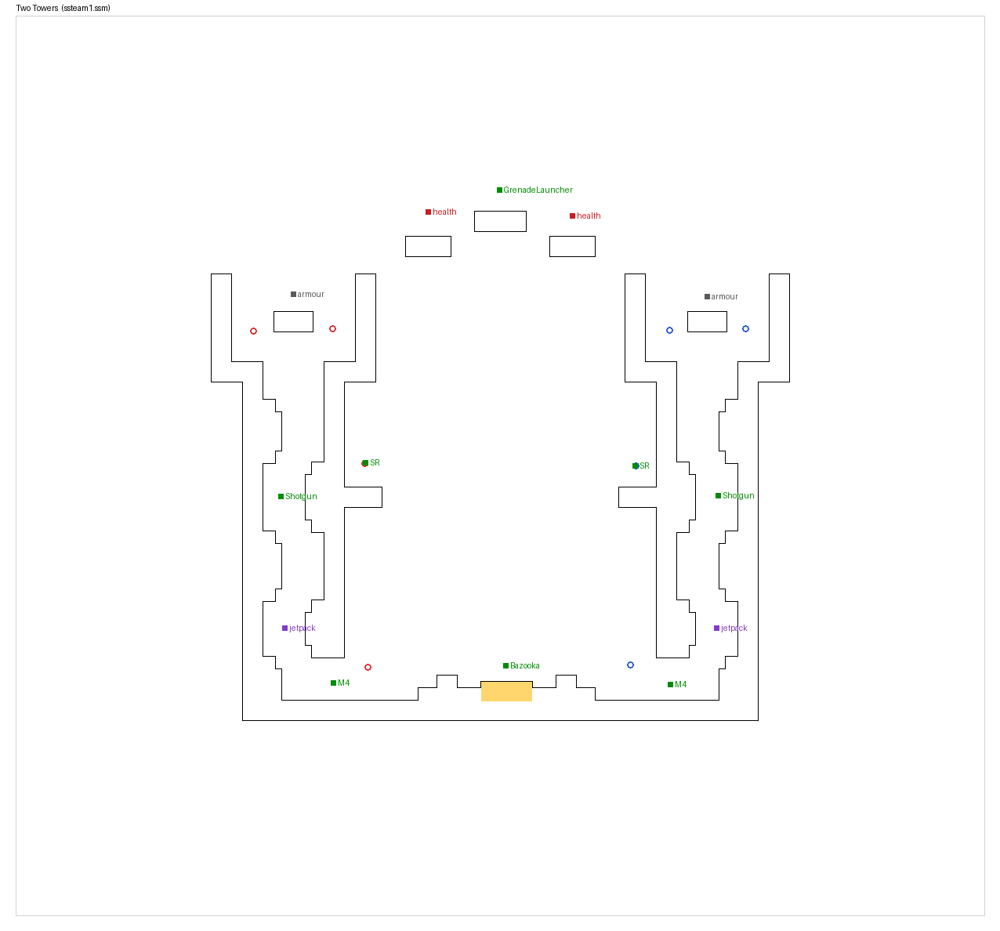
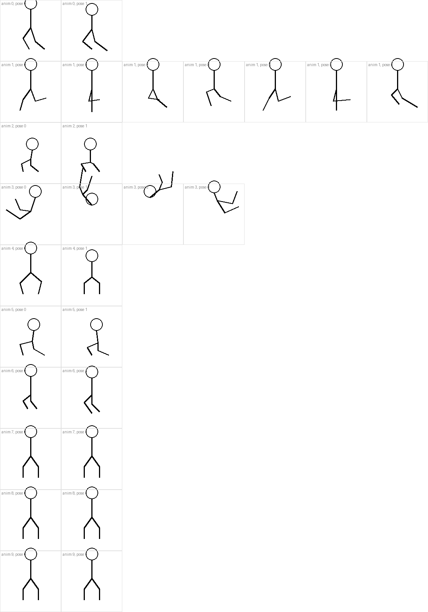
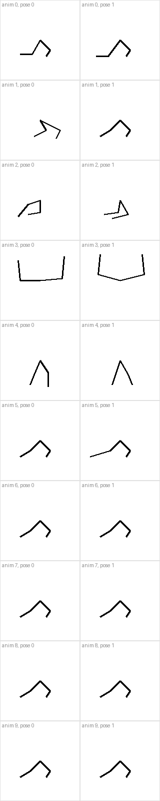

# Stick Soldiers II: reference material

Everything useful pulled out of the original **Stick Soldiers II** (Whitespace Unlimited, 2003): its maps, weapon stats, stick-figure animations and bot settings, decoded into JSON with preview images.

The original source code was never released and is reportedly lost, so this is built from the shipped game files. File formats are documented in [`docs/ss2-file-formats.md`](../../docs/ss2-file-formats.md).

## What's in this folder

| Folder | Contents | In git? |
|---|---|---|
| `data/` | Decoded gameplay data (JSON) and preview images drawn by our tool | Yes |
| `original/` | The raw game files from `ss2.zip` | No, git-ignored |
| `assets/` | The original sprites (as PNG), sounds (WAV) and screenshots | No, git-ignored |

The original art and sounds belong to Whitespace Unlimited. They're useful as reference and placeholders, but this repo is public, so they're kept out of git until we decide otherwise.

### Regenerating

```sh
pip install Pillow                                  # only needed for the PNG output
python3 tools/ss2/extract.py path/to/ss2.zip
```

The zip is the Internet Archive copy (<https://archive.org/details/ss2_20221120>). The tool never extracts or runs the game's `.exe`.

## The original game

- **Made by:** Tim Cowley "YodaTheCoda" (lead programmer), Dylan Allison "AntilogicHyper" (lead artist and sound) and Andrew Vehlies "SuperRoy" (webmaster), as Whitespace Unlimited.
- **Look:** white background, black outlined level geometry, black stick figures, small coloured weapon sprites.
- **Modes:** free-for-all and team deathmatch against bots. Capture the flag was started but never finished.
- **Pickups:** weapons, health, armour and jetpacks (fuel-based; can be dropped with Z).
- **Tools:** a built-in map editor and animator, opened from the console.

Two Towers, decoded from `ssteam1.ssm`. It matches the in-game screenshots in `assets/screenshots/` exactly:



### Maps

Click a name for its preview. Previews show platforms (black outline), jump pads (yellow), team spawns (blue = team 1, red = team 2) and pickups.

| Map | File | Size (px) | Platforms | Jump pads | Spawns | Weapons on map | Other pickups |
|---|---|---|---|---|---|---|---|
| [Fire in the Hole](data/maps/ssdm1.png) | `ssdm1.ssm` | 1908×828 | 21 | 0 | 14 | Bazooka ×2, Flamer, GrenadeLauncher, M4 ×4, SR ×2, Shotgun | armour, health ×2, jetpack ×2 |
| [Habitat](data/maps/ssdm2.png) | `ssdm2.ssm` | 1269×1061 | 25 | 0 | 8 | GrenadeLauncher ×2, M4 ×2, SR ×2, Shotgun ×2 | – |
| [King of the Hill](data/maps/ssdm3.png) | `ssdm3.ssm` | 1428×1093 | 18 | 0 | 10 | GrenadeLauncher, M4 ×4, SR ×2, Shotgun | health |
| [Fraghouse](data/maps/ssdm4.png) | `ssdm4.ssm` | 1276×908 | 15 | 0 | 14 | Bazooka, GrenadeLauncher, M4 ×4, SR ×2, Shotgun ×2 | health ×2 |
| [Sniping Grounds](data/maps/ssdm5.png) | `ssdm5.ssm` | 1780×804 | 15 | 0 | 12 | GrenadeLauncher ×2, M4 ×2, SR ×2 | armour, health ×4, jetpack ×2 |
| [Fatality Zone](data/maps/ssdm6.png) | `ssdm6.ssm` | 1940×1116 | 27 | 2 | 14 | Bazooka ×2, Flamer, GrenadeLauncher ×2, M4 ×2, SR ×2, Shotgun ×2 | armour, health ×4 |
| [Hells Steeple](data/maps/ssdm7.png) | `ssdm7.ssm` | 1636×1252 | 24 | 8 | 10 | Bazooka, GrenadeLauncher ×3, M4 ×4, SR ×2, Shotgun ×2 | armour ×2, jetpack ×2 |
| [Two Towers](data/maps/ssteam1.png) | `ssteam1.ssm` | 1236×1148 | 44 | 1 | 8 | Bazooka, GrenadeLauncher, M4 ×2, SR ×2, Shotgun ×2 | armour ×2, health ×2, jetpack ×2 |

### Weapons

From [`data/weapons.json`](data/weapons.json). "Fire delay" is time between shots (lower is faster). "Power" is probably damage and knockback. "Accuracy" is aim error (0 is perfect). See the format doc for every field.

| Weapon | id | Behaviour | Fire delay | Power | Accuracy | Ammo | Notes |
|---|---|---|---|---|---|---|---|
| Platinum | `Platinum` | Platinum | 20 | 20, 10 | 6 | 8 | Pistol, reloads automatically |
| M4 Carbine | `M4` | M4 | 8 | 12, 9 | 4 | 60 | `RPG=True` (probably a secondary-fire grenade) |
| Shotgun | `Shotgun` | SG | 50 | 7.5, 2.5 | – | 8 | 11 pellets, spread 12 |
| Uzi | `Uzi` | M4 | 5 | 11, 4 | 6 | 100 | Not placed on any shipped map |
| Sniper Rifle | `SR` | SR | 60 | 50, 50 | 0 | 10 | Laser sight; B to zoom |
| Bazooka | `Bazooka` | RL | 150 | – | – | 5 | |
| Grenade Launcher | `GrenadeLauncher` | GL | 50 | – | – | 10 | Grenades explode after 3 seconds |
| Flamethrower | `Flamer` | Flamer | 3 | 1 | 4 | 200 | |

**Cut weapons** found in two older weapon tables, never in the released game. Most have sprites in the game files already:

| Weapon | id | Behaviour | Fire delay | Power | Accuracy | Ammo |
|---|---|---|---|---|---|---|
| AK-47 | `AK47` | M4 | 11 | 15, 20 | 11 | 40 |
| MP5K | `MP5K` | M4 | 6 | 10, 4 | 6 | 60 |
| 20mm Cannon | `20mm` | M4 (`Cannon=True`) | 12 | 10, 10 | 3 | – |
| Beretta | `Beretta` | Platinum | 20 | 20, 10 | 1 | – |
| Rocket Launcher | `RocketLauncher` | – | – | – | – | – |
| C4 Detonator | `C4` | C4 | 50 | – | – | 3 |
| Blaster | `Blaster` | Blaster | – | – | 6 | – |
| Shocker | `Shocker` | Shocker | – | 1, 1 | – | 300 |

### Stick-figure animation

The soldier is a handful of points joined by lines, with legs and arms animated separately (so it can run while aiming). Each sheet below shows every key pose in the original animation files: one row per animation, one cell per pose.

| Legs ([`legs.json`](data/animations/legs.json)) | Arms ([`arms.json`](data/animations/arms.json)) |
|---|---|
|  |  |

### Other data

- [`data/controls.json`](data/controls.json): default key bindings.
- [`data/bots.json`](data/bots.json): the 10 bot personalities (aim, camping, skill, chattiness) plus 3 unfinished CTF bot classes.
- [`data/sprite-atlas.json`](data/sprite-atlas.json): which sprite lives where in which image.
- [`data/sounds.json`](data/sounds.json): the sound list.

### Missing from this copy of the game

The game expects these, but they aren't in the zip: the menu background (`SSMenu.tga`), the music (`MenuMusic.wav`, `GameMusic01.wav`, `GameMusicEnd.wav`) and a `Data/MapObjects/` folder.
